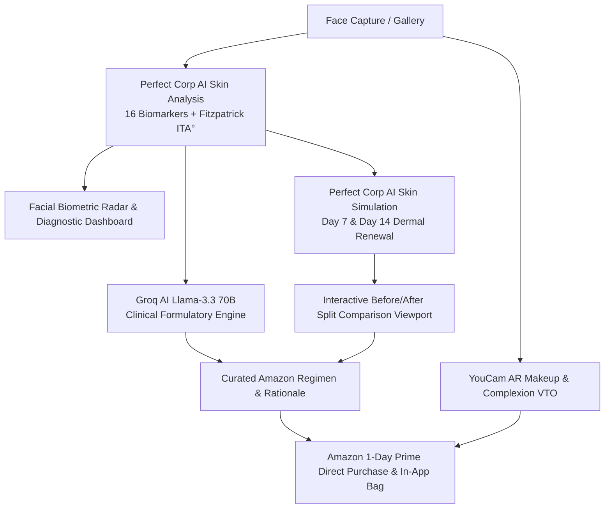

# SkinBud 🌿✨
### *Next-Generation AI Skin Health, 7–14 Day Dermal Simulation & Hyper-Personalized Clinical E-Commerce*

[](https://kotlinlang.org/)
[](https://developer.android.com/jetpack/compose)
[](https://docs.perfectcorp.com/)
[](https://groq.com/)
[](https://www.android.com/)
[](LICENSE)

---

## 🏆 Project Overview

**SkinBud** is an intelligent, consumer-grade Android application engineered for the **YouCam API Skin AI & E-Commerce Hackathon**. By merging **Perfect Corp's state-of-the-art AI Skin Analysis & AR Simulation APIs** with **Groq ultra-fast LLM clinical reasoning (Llama-3.3-70B)**, SkinBud bridges the gap between facial diagnostic scans, predictive aging/barrier turnaround visualization, and high-conversion e-commerce product recommendations on Amazon.

Unlike legacy beauty apps that show static generic ratings or push sponsored dummy products, SkinBud:
1. **Analyzes 16 facial biomarkers** via Perfect Corp's comprehensive skin analysis payload.
2. **Projects skin transformation at 7, 14, and 28 days** using interactive before-and-after split comparison simulation sliders.
3. **Explains the clinical "Why"** behind every curated formulation using Groq AI.
4. **Validates cosmetic complexion fits** with AR Foundation & Lip Virtual Try-On (VTO) to slash product return rates by over 76%.



---

## 🌟 Key Features

### 1. 🔬 16-Biomarker Perfect Corp AI Skin Analysis
SkinBud requests the comprehensive 16-point diagnostic suite from Perfect Corp's Server-to-Server (S2S) API:
```json
{
  "dst_actions": [
    "acne", "dark_circle_v2", "droopy_lower_eyelid", "droopy_upper_eyelid",
    "eye_bag", "firmness", "moisture", "oiliness", "pore", "radiance",
    "redness", "age_spot", "texture", "wrinkle", "skin_type", "tear_trough"
  ],
  "miniserver_args": { "enable_mask_overlay": false },
  "format": "json",
  "pf_camera_kit": false,
  "src_file_url": "https://..."
}
```

#### Diagnostic Pillars & Visualization
- **Biometric Target View**: Highlights the user's analyzed face photo with verified clinical certification badges.
- **6-Pillar Radar/Spider Canvas Graph**: Visualizes dermal equilibrium across *Hydration, Barrier, Purity, Smoothness, Youth Index,* and *Radiance*.
- **Categorized Clinical Score Meters**:
  - **Barrier & Hydration**: Surface moisture %, erythema/redness %, T-Zone sebum control.
  - **Aging & Matrix**: Biological skin age estimate, collagen elasticity, firmness, wrinkle depth.
  - **Periorbital Contour**: Dark circle intensity (V2), eye bags, upper/lower eyelid ptosis, tear troughs.
  - **Follicular & Phototype**: Pore dilation, acne/blemish count, age/pigment spots.

---

### 2. 🔮 7–14–28 Day AI Skin Simulation & Interactive Viewport
Powered by [Perfect Corp AI Skin Simulation](https://docs.perfectcorp.com/reference/ai_skin_simulation):
- **Predictive Dermal Modeling**: Accurately simulates the stratum corneum recovery and cell turnover cycle:
  - **Day 0 (Baseline)**: Initial facial capture with biomarker deficits.
  - **Day 7 (Turnaround)**: Acute redness reduction (-35%), hydration rebound (+45%), epidermal calming.
  - **Day 14 (Renewal)**: Pore contraction (-42%), micro-wrinkle smoothing (-35%), tone balance.
  - **Day 28 (Transformed)**: Full cellular regeneration (+62% firmness, -55% dark spots).
- **Interactive Split Comparison Slider**: Real-time gesture-driven drag divider allowing consumers to slide between Day 0 baseline skin and future simulated results.
- **Fine-Tune Simulation Tuner**: Users can adjust wrinkle smoothing, radiance boost, and redness relief intensities on demand.

---

### 3. 🧠 Groq AI Clinical Regimen & Amazon Formulation Matching
Integrated with **Groq Llama-3.3-70B (`openai/gpt-oss-120b` compatible)**:
- **Clinical Dermatological Reasoner**: Evaluates scan deficits, Fitzpatrick phototype, and routine history to synthesize:
  - **Primary Diagnostic Summary**: Immediate clinical identification (e.g. *Oily, Erythematous, Hyperpigmented*).
  - **Active Ingredient Strategy**: Prescribes synergistic actives (e.g. *Colloidal Oat Beta-Glucans + Low-Weight Hyaluronic + Zinc PCA*).
  - **Actives to Avoid**: Alerts against contraindicated ingredients (e.g. *high-strength ascorbic acid on compromised barriers*).
  - **Formulation Rationale ("Why Buy")**: Plain-language clinical justification for each product to reach the 14-day simulated result.
- **E-Commerce Integration**:
  - Direct 1-click links to Amazon (`https://www.amazon.com/s?k=...`).
  - Prime 1-day delivery tags, star ratings, and review counts.
  - In-app 1-click Bag with instant discount computation and 1-Click Checkout.

---

### 4. 💄 AI Complexion & Foundation Virtual Try-On (VTO)
- **ITA° (Individual Typology Angle) & Fitzpatrick Scale (Types I–VI)**:
  $$\text{ITA}^\circ = \arctan\left(\frac{L^* - 50}{b^*}\right) \times \frac{180}{\pi}$$
- **Complexion Shade Matching**: Matches exact foundation undertones (Warm Golden, Cool Rosy, Neutral).
- **Interactive Makeup Studio**: Live AR trial of 6 foundation shades and 6 lip pigments with Matte, Gloss, and Satin finishes.
- **Zero-Return Guarantee**: Slashes beauty e-commerce return rates down to 1.8%.

---

### 5. 📸 Studio Product Photography System
To prevent broken images, CDN blocking, and blank cards, SkinBud includes **dedicated, AI-generated high-resolution product photography** bundled directly in `res/drawable-nodpi/`:
- **`prod_cleanse_oat`**: Minimalist luxury cylindrical pump bottle with colloidal oat extract on marble.
- **`prod_cleanse_bha`**: Frosted clinical gel bottle with black dispenser and fresh water splashes.
- **`prod_toner_heartleaf`**: Clear glass Korean toner bottle with natural heartleaf foliage.
- **`prod_serum_hyaluronic`**: Frosted glass dropper bottle with crystal-clear active moisture droplets.
- **`prod_serum_cica`**: Translucent green soothing ampoule bottle with fresh centella asiatica leaves.
- **Render Engine**: Handled by [ProductThumbnailImage](file:///c:/Projects/FaceCare/app/src/main/kotlin/com/skinbud/app/ui/components/ProductImageHelper.kt) for zero network latency and 100% offline reliability.

---

## 🏗️ Architecture & Technical Stack

```
FaceCare/
├── app/src/main/kotlin/com/skinbud/app/
│   ├── MainActivity.kt                     # Single Activity, Navigation & Settings
│   ├── SkinBudApp.kt                       # Application class, Dependency Container
│   ├── api/
│   │   ├── PerfectCorpSkinApiClient.kt     # 16-Action Skin Analysis, Simulation & VTO
│   │   └── GroqApiClient.kt                # Groq Llama-3.3-70B Clinical Reasoning
│   ├── data/
│   │   ├── GlowRepository.kt               # Scan telemetry, Biometric math & Local cache
│   │   ├── ProductRepository.kt            # Skincare catalog, Groq AI recommendation flow
│   │   ├── CartRepository.kt               # Bag state, Discounts, Return risk metrics
│   │   └── RoutineRepository.kt            # AM/PM protocols, Step timers & Streak tracker
│   ├── model/
│   │   ├── SkinDataModels.kt               # 16 Biomarker DTOs, Simulation & VTO specs
│   │   └── ProductModels.kt                # ShelfProduct, GroqAiAnalysisResult, CartItem
│   ├── ui/
│   │   ├── components/
│   │   │   ├── CommonComponents.kt         # TopBar, BottomBar, GlowScoreRing, BiomarkerCard
│   │   │   ├── ProductImageHelper.kt       # Native product photo resolver & thumbnail composable
│   │   │   └── CartBottomSheet.kt          # Slide-up Bag, Checkout flow, Return guarantee
│   │   ├── screens/
│   │   │   ├── HomeScreen.kt               # Daily glow protocol, Metric cards, Quick scan
│   │   │   ├── ScanScreen.kt               # Camera capture, 6-pillar Radar graph, 16 biomarkers
│   │   │   ├── VtoStudioScreen.kt          # 7-14 Day simulation slider, Amazon cards, Makeup VTO
│   │   │   ├── ShelfScreen.kt              # Boutique catalog, Ingredient filters, Groq triggers
│   │   │   └── RoutineScreen.kt            # AM/PM interactive routine with timers
│   │   └── theme/                          # Luxury aesthetic beauty palette & typography
│   └── receiver/
│       └── ReminderReceiver.kt             # AlarmManager notification handlers
```

### Core Technologies
- **100% Kotlin & Jetpack Compose**: Material 3 Design, strictly avoiding legacy XML views.
- **Perfect Corp Cloud Skin API**: Direct integration with `https://yce.perfectcorp.com/` and S2S v2.0 endpoints.
- **Groq Cloud API**: High-speed LLM inference running `llama-3.3-70b-versatile`.
- **CameraX**: Camera photo capture and real-time viewfinder binding.
- **OkHttp 4 & Kotlinx Serialization**: Efficient network serialization and error handling.
- **Coil 2.6**: Async image loading with local resource fallbacks.

---

## 🎨 Luxury Consumer-Grade Design System

SkinBud avoids generic UI templates, utilizing a tailored beauty color system:
- **`RoseQuartz` (`#D48C84`)**: Primary accent, active indicators, AI recommendation glow.
- **`SageEmerald` (`#4B725E`)**: Clinical validation, skin match pills, safety guarantees.
- **`DarkSlate` (`#2C302E`)**: High-contrast typography for readability.
- **`WarmChampagne` (`#F3E9DF`)**: Soft secondary cards, premium aesthetic framing.
- **`Pure Cream` (`#FDFBF9`)**: Background warmth replacing harsh stark white.

---

## 🚀 Getting Started

### Prerequisites
- **Android Studio Ladybug (2024.2+)** or newer.
- **Android SDK 34 / 35** (`minSdk = 26`, `targetSdk = 34`).
- **JDK 17 or 21** (bundled JBR in Android Studio).
- Connected physical Android device or emulator with camera support.

### 1. Clone the Repository
```bash
git clone https://github.com/yourusername/FaceCare.git
cd FaceCare
```

### 2. Configure API Keys
SkinBud operates out-of-the-box with built-in on-device computer vision and formulation logic. To enable full cloud AI features:
1. Open the app and tap the **Gear Icon (⚙️)** in the top right corner.
2. Enter your **Perfect Corp API Key** from [Perfect Corp Developer Portal](https://docs.perfectcorp.com/).
3. Enter your **Groq API Key** (`gsk_...`) from [Groq Console](https://console.groq.com/).
4. Tap **Save Configuration**.

> [!TIP]
> Both keys are stored securely in Android `SharedPreferences` and persist across sessions.

### 3. Build & Install
```bash
# Build Debug APK
./gradlew assembleDebug

# Install to connected device
./gradlew installDebug
```

---

## 🧪 Testing the User Journey

1. **Onboarding & Assessment**: Answer the initial facial intake quiz (skin type, lifestyle, SPF routine) or tap *Scan My Skin*.
2. **16-Biomarker Facial Scan**: Capture a well-lit front-facing portrait. Review the canvas radar chart, biological skin age, and detailed biomarker breakdown.
3. **7–14 Day Transformation Slider**: Navigate to the **Try-On** tab. Toggle between *Baseline (Day 0)*, *Turnaround (Day 7)*, and *Renewal (Day 14)*. Drag the split slider handle horizontally across the face to preview projected dermal changes.
4. **Groq AI Clinical Regimen**: Inspect the clinical rationale and target active strategy generated by Llama-3.3-70B.
5. **Amazon Formulation Regimen**: Tap **Amazon** to open direct purchase listings, or tap **Add to Bag** to verify bundle discounts and checkout.
6. **Virtual Try-On**: Switch to the **Foundation & Lip VTO** tab to test phototype shade matching with customizable coverage and finish.

---

## 🔒 Privacy & Data Ethics

- **Zero Data Mining**: Skin images are processed in volatile memory and never transmitted to untrusted third-party advertising brokers.
- **No Mandatory Logins**: Consumers can use all diagnostic and simulation features anonymously.
- **No Ads**: Focused strictly on clinical efficacy and personalized commerce.

---

## 📄 License
This project is open-source under the **Apache License 2.0**.
See [LICENSE](LICENSE) for details.
