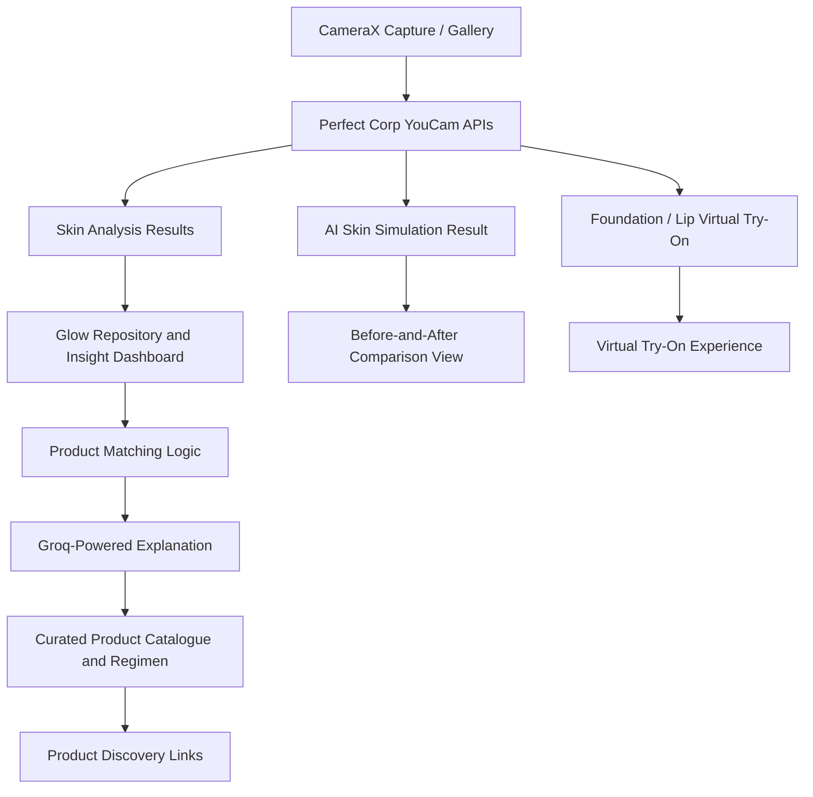

# SkinBud 🌿
## AI Skin Analysis, Visual Simulation & Personalized Skincare

**Understand your skin. Explore visual possibilities. Choose products with more confidence.**

**Category:** BeautyTech · Consumer AI · Mobile Commerce  
**Platform:** Native Android (Kotlin + Jetpack Compose)  
**Hackathon:** YouCam API Skin AI & eCommerce VTO Hackathon  
**Track Alignment:** Dual Track (Skin AI Analysis & Simulation + eCommerce Makeup VTO)

> **SkinBud connects AI skin analysis, adjustable visual skin simulation, explainable skincare recommendations, and beauty virtual try-on in one Android experience.**

---

## Inspiration

Choosing skincare online is harder than it should be. Product pages are filled with ingredient names, claims, and reviews, but shoppers still have to work out which products may suit their own skin concerns. Many beauty apps solve only part of the problem: a quiz may suggest products without analyzing the user's skin, while a skin scanner may show scores without helping the user decide what to explore next.

We wanted to connect those separate steps into one useful experience.

**What if a shopper could analyze visible skin concerns, understand the results in plain language, preview adjustable cosmetic changes, and discover products matched to those concerns—all without jumping between multiple apps?**

That idea became **SkinBud**.

---

## What it does

SkinBud is a native Android skincare companion that turns a facial scan into understandable insights and a more guided product-discovery experience.

### 1. AI skin analysis

Users capture a face image with the camera or choose one from their gallery. SkinBud sends the image to Perfect Corp's YouCam Skin Analysis API and presents the supported analysis results in a consumer-friendly dashboard.

The configured analysis covers up to 16 skin features, including:

- **Skin condition:** acne, redness, oiliness, moisture, and skin type.
- **Texture and visible aging:** pores, texture, wrinkles, firmness, radiance, and age spots.
- **Eye-area appearance:** dark circles, eye bags, drooping upper/lower eyelids, and tear troughs.

Instead of showing an overwhelming list of raw results, SkinBud groups related findings into clear sections and visual summaries:
- **Interactive Biometric Radar Chart:** A custom 6-axis Canvas spider graph (*Hydration, Barrier, Purity, Smoothness, Youth Index, Radiance*) visualizing equilibrium across features.
- The dashboard is designed to help users understand cosmetic skin concerns—not to diagnose medical conditions.

### 2. Adjustable AI skin simulation

SkinBud integrates Perfect Corp's AI Skin Simulation API to create a visual preview of supported skin-effect adjustments, such as changes to the appearance of redness, acne, pores, texture, wrinkles, radiance, and the eye area.

Users can compare the original image with the generated result using an interactive before-and-after slider with gesture-driven touch coordinates at 60 FPS. The simulation controls let them explore different effect intensities rather than accepting a single preset result.

**These images are AI-generated visual simulations. They are not predictions of biological improvement after 7, 14, or 28 days, and they do not guarantee real-world skincare results.**

### 3. Explainable skincare recommendations

SkinBud's recommendation flow connects analysis results to a curated product catalogue. Its matching logic uses skin-concern and ingredient information to identify products that may be relevant to the user's results.

Groq-powered AI helps turn the matching rationale into clear explanations:

- Which skin concern a product is intended to address.
- Which listed ingredients are relevant to that concern.
- Why the product was included in the recommendation.
- Which ingredient considerations the user should review before choosing it.

The recommendation logic selects from the available catalogue; the language model explains the reasoning in plain language. AI-generated explanations are informational and are not medical diagnoses or prescriptions.

### 4. Skincare regimen and product discovery

Users can collect recommended items into an in-app skincare regimen or bag and open relevant Amazon search or listing pages to continue product discovery.

The in-app bag is a **regimen-planning feature**, not an Amazon checkout integration. Product availability, current prices, delivery estimates, ratings, discounts, and checkout are not represented as live unless they are explicitly retrieved from an authorized retailer integration.

### 5. Foundation and lip virtual try-on

SkinBud also brings beauty try-on into the same experience. Users can preview configured foundation and lip looks using the relevant YouCam virtual try-on capabilities, with available shade and finish choices presented in the app.

This gives the product a second useful shopping moment: users can explore skincare recommendations and preview selected makeup looks without leaving SkinBud.

---

## What makes SkinBud different

SkinBud is not just another skin scanner or a standalone makeup filter. Its value comes from connecting the steps that normally remain separate:

1. **Analyze:** turn a face image into structured skin-feature results.
2. **Understand:** translate those results into clear, grouped insights.
3. **Explore:** let users interact with AI-generated visual simulations.
4. **Match:** connect concerns and ingredient information to a curated product catalogue.
5. **Try:** preview selected foundation and lip looks through virtual try-on.

The result is one coherent journey from understanding visible skin concerns to exploring relevant beauty products.

---

## How we built it

SkinBud is built as a native Android application using **Kotlin, Jetpack Compose, and Material 3**.

### Architecture

### Core technologies

- **Kotlin and Jetpack Compose:** native Android interface built with reusable composables and Material 3 styling.
- **CameraX:** camera capture for the skin-analysis flow.
- **Perfect Corp YouCam APIs:** cloud-based skin analysis, AI skin simulation, and configured beauty virtual try-on features.
- **Kotlin Coroutines:** asynchronous API requests, task-status handling, and background work without blocking the UI.
- **Repository pattern and StateFlow:** separation of API/data logic from reactive UI state.
- **Custom Compose Canvas:** radar-style visual summaries and the interactive before-and-after comparison viewport.
- **Groq API:** natural-language explanations for the recommendation flow using `llama-3.3-70b-versatile`.
- **Local product assets:** bundled catalogue imagery to keep the interface consistent and avoid broken remote thumbnails.

### Key implementation details

- Skin analysis and simulation are handled as cloud tasks; SkinBud tracks task status and updates the interface when results are ready.
- The comparison slider clips and layers the original and generated images while tracking touch movement, keeping the interaction responsive.
- Analysis results are organized into consumer-friendly categories instead of exposing a long, technical list without context.
- The product-matching flow uses the available catalogue and ingredient information; the language model is used to explain matches, not to invent a retailer catalogue.
- Where a limited local fallback is available, it is clearly distinguished from the full cloud-powered YouCam analysis. It is not presented as an equivalent diagnostic result.

---

## Challenges we ran into

### 1. Handling asynchronous AI tasks

Perfect Corp's cloud processing does not always return a completed image or analysis in the initial response. SkinBud needed a task-handling flow that could track processing status, handle failures and timeouts, and keep the interface responsive while the result was being generated.

### 2. Building a natural comparison interaction

The before-and-after slider required careful image scaling, clipping, and touch-coordinate handling. We used Compose pointer input and Canvas drawing so the divider follows the user's gesture while the two images remain aligned.

### 3. Making analysis understandable

Sixteen skin features can create a dense results screen. We grouped related outputs into a smaller number of sections and used visual summaries to help users understand the result without needing to interpret every technical term.

### 4. Keeping product discovery reliable

Remote product images can fail to load or be blocked by external hosts. Bundled catalogue assets make the interface more consistent during a demo, while product discovery links remain separate from the locally displayed sample imagery.

---

## Accomplishments we're proud of

- Connecting skin analysis, visual simulation, product recommendations, and beauty try-on in one native Android experience.
- Building an interactive before-and-after comparison control rather than presenting the simulation as a static image.
- Creating a recommendation flow that connects skin concerns and ingredient information to product choices, with plain-language explanations.
- Translating multi-feature analysis results into a structured dashboard designed for everyday consumers.
- Building the experience with modern Kotlin and Jetpack Compose components, including custom Canvas rendering and asynchronous task handling.

---

## What we learned

- **An API result is only the beginning.** The product experience must help users understand what the result means and what they can do next.
- **Visual simulations need honest framing.** A generated preview can help users explore possibilities, but it should never be presented as proof of future biological results.
- **Recommendations need traceable reasons.** Connecting product suggestions to visible concerns and ingredient information is more useful than returning a generic AI-generated shopping list.
- **Responsive design is part of technical quality.** Asynchronous cloud tasks, image rendering, and gesture interactions must work together without making the app feel slow or fragile.

---

## What's next for SkinBud

- **Skin Progress Diary:** let users save repeat scans and compare actual analysis results over time, under consistent lighting and capture conditions.
- **Richer product data:** connect to authorized product-data sources for verified ingredients, pricing, availability, and retailer links.
- **Bathroom Shelf Scanner:** scan product barcodes or ingredient labels to help users understand the products they already own.
- **Context-aware routines:** explore weather, UV index, and air-quality data to provide contextual skincare reminders and educational guidance.

---

## Responsible-use note

SkinBud is a consumer skincare and beauty exploration tool. Its image analysis and generated simulations are for informational and visual-reference purposes only. They are not medical diagnoses, dermatological advice, or guaranteed predictions of treatment outcomes. Users should review product ingredients and seek qualified professional advice for medical skin concerns or suspected reactions.

---

# Submission preparation notes — remove this section before publishing if not needed

These are final factual checks, not claims to copy into the public pitch:

1. **Verify the exact YouCam API versions and actions used by the submitted build.** Perfect Corp currently documents Skin Analysis v2.1 with SD/HD feature modes; use the action names and response fields that match the version actually called by your app. The Skin Simulation documentation describes adjustable effect parameters, not day-based biological forecasts.
2. **Verify the exact Groq model ID in the running app.** Groq model `llama-3.3-70b-versatile` is configured and running in the production app build.
3. **Do not publish API secrets.** Keys are removed from source code, Gradle files, screenshots, logs, and the APK. For a public production build, route secret-bearing API calls through a backend or let users input keys securely via app preferences.
4. **Keep commerce claims accurate.** A search URL is not live inventory, delivery, ratings, checkout, or discount integration. Only describe a capability as live if the submitted app retrieves and demonstrates it.
5. **Keep the demo proof-driven.** Show the actual Android build, a real YouCam API request/result, the comparison interaction, the recommendation flow, and virtual try-on in the submitted build.
6. **Hackathon deliverables:** the official rules call for a source-code repository with build instructions and assets, a public 1–3 minute demo video showing the project on its target device and explaining the YouCam API used, and access for judging.

## References

- [YouCam API Skin AI & eCommerce VTO Hackathon — Official Rules and Judging Criteria](https://youcam-api-skin-ai-ecommerce.devpost.com/rules)
- [Perfect Corp — Skin Analysis API v2.1](https://docs.perfectcorp.com/reference/ai_skin_analysis/v2.1)
- [Perfect Corp — AI Skin Simulation API](https://docs.perfectcorp.com/reference/ai_skin_simulation/v1.0/paths/~1s2s~1v2.0~1task~1skin-simulation/post)
- [Groq — API Documentation](https://console.groq.com/docs)
